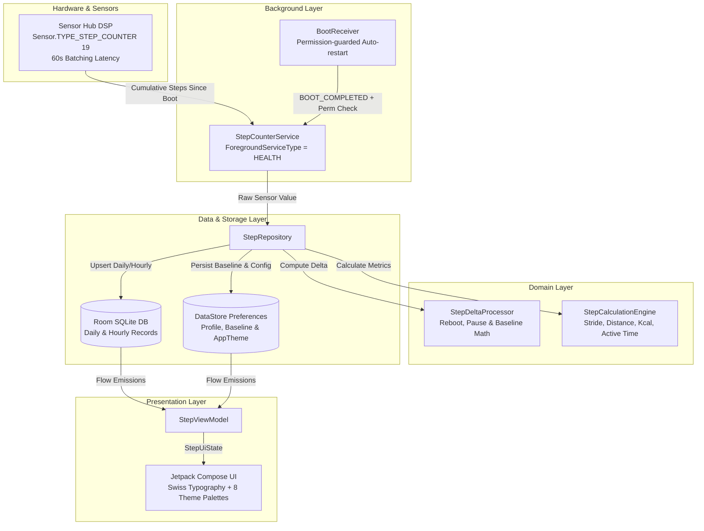

# Nordic Step Counter - Architectural Design Specification

**Date:** 2026-11-10  
**Project:** Nordic Step Counter (Clean-room Android Pedometer)  
**Target Package:** `com.nordic.stepcounter`  
**Reference App Analyzed:** `steptracker.healthandfitness.walkingtracker.pedometer` (44.5 MB)

---

## 1. Problem & Context

Commercial pedometer applications (such as the analyzed `Step.apk`) provide useful daily tracking features but are heavily weighed down by:

- Over 31 MB of multi-dex code and dynamic DEX assets dedicated to AdMob, Meta Audience Network, and tracking SDKs.
- Continuous background telemetry services (`AppMeasurementService`, `SessionLifecycleService`, `CctBackendFactory`).
- Invasive permissions including background fine/coarse GPS location (`ACCESS_BACKGROUND_LOCATION`) and Google Advertising IDs (`AD_ID`, `ACCESS_ADSERVICES_AD_ID`).

The goal of this project is to build a modern, high-performance, battery-efficient, and privacy-respecting Android step tracker inspired by the core feature set of `Step.apk`, engineered with a **Minimalist Nordic / Swiss** typographic layout and a **Multi-Theme Palette Engine** (Nordic, Gruvbox, Catppuccin, and TokyoNight in both Dark and Light variants).

---

## 2. Reverse Engineering Findings vs Clean Target

| Dimension                   | Reference App (`Step.apk`)                                           | Nordic Step Counter (Clean Clone)                               |
| :-------------------------- | :------------------------------------------------------------------- | :-------------------------------------------------------------- |
| **Download / Install Size** | 44.5 MB (4 DEX files + dynamic asset DEX)                            | ~3 - 5 MB (Single DEX, stripped dependencies)                   |
| **Ad Networks & SDKs**      | Google AdMob, Meta Audience Network, AppLovin                        | **None (Zero ads)**                                             |
| **Telemetry & Trackers**    | Firebase Analytics, Firebase Sessions, Google Transport              | **None (Zero trackers)**                                        |
| **Network Permission**      | `android.permission.INTERNET` requested                              | **No `INTERNET` permission in manifest**                        |
| **Location Permission**     | Background & Fine GPS requested                                      | **No GPS location permissions requested**                       |
| **Step Sensor Logic**       | Hardware `Sensor.TYPE_STEP_COUNTER` (19) + `TYPE_STEP_DETECTOR` (18) | Dedicated `Sensor.TYPE_STEP_COUNTER` (19) with 60s DSP batching |
| **UI Aesthetics & Themes**  | Ad banners, popups, cluttered gamification                           | Swiss / Nordic typography + 8 developer-loved color palettes    |

---

## 3. High-Level Architecture

The application adopts Clean Architecture with Unidirectional Data Flow (UDF) powered by Jetpack Compose, Kotlin Coroutines, and Android Jetpack libraries. Because `StepCounterService` and `MainActivity` share single-process Room and DataStore `Flow` streams, no `bindService()` / `IBinder` coupling is needed.



---

## 4. Hardware Sensor Engine, State Math & Android 14/15 Compliance

1. **Low-Power Hardware Batching (`Sensor.TYPE_STEP_COUNTER`):**
   - Android's `Sensor.TYPE_STEP_COUNTER` (sensor ID 19) operates inside the device's low-power sensor hub DSP. It counts steps continuously without keeping the main Application Processor (CPU) awake.
   - `StepSensorManager` registers the listener with `maxReportLatencyUs = 60_000_000` (60 seconds) so the hardware buffers steps in batches while the screen is off. `Sensor.TYPE_STEP_DETECTOR` (18) is intentionally omitted to avoid unbatched per-step CPU wakeups.
2. **Cumulative Delta, Reboot, Pause & Midnight Rollover Resolution:**
   - Because `Sensor.TYPE_STEP_COUNTER` emits cumulative steps since the last boot, `ProfilePreferences` persists `lastSensorStepValue: Long`.
   - `StepDeltaProcessor` processes every sensor event:
     - **First Reading (`lastSensorStepValue == -1L`):** Sets `newBaseline = current`, `stepsToAdd = 0`.
     - **Paused State (`isPaused == true`):** Advances `newBaseline = current` and returns `stepsToAdd = 0`. This guarantees steps taken while paused (e.g., in transit) are never added when the user resumes tracking.
     - **Reboot Detected (`current < lastSensorStepValue`):** Recognizes hardware counter reset and sets `stepsToAdd = current`, `newBaseline = current`.
     - **Normal Increment (`current >= lastSensorStepValue`):** Sets `stepsToAdd = current - lastSensorStepValue`, `newBaseline = current`.
   - `StepRepository` queries `LocalDate.now()` and `LocalTime.now().hour` on each batch, seamlessly creating a new `DailyStepEntity` at midnight and bucketing steps into the active `HourlyStepEntity`.
3. **Android 14/15 (`targetSdk 35`) Foreground Service Safety:**
   - Declared as `android:foregroundServiceType="health"` and promoted via `ServiceCompat.startForeground(..., ServiceInfo.FOREGROUND_SERVICE_TYPE_HEALTH)`.
   - Both `BootReceiver` (`ACTION_BOOT_COMPLETED`) and `StepCounterService.onStartCommand()` explicitly verify `ContextCompat.checkSelfPermission(context, Manifest.permission.ACTIVITY_RECOGNITION) == PERMISSION_GRANTED` before starting or promoting the service, preventing `SecurityException` crashes on Android 14/15.

---

## 5. Physical Calculation Models

Calculations are parameterized using the user's personal profile (stored locally in DataStore):

1. **Step Length ($L$ in meters):**
   - Default based on user height ($H$ in cm):
     $$\text{Female: } L = H \times 0.413 \div 100$$
     $$\text{Male: } L = H \times 0.415 \div 100$$
   - Can be manually overridden in settings.
2. **Distance ($D$ in km):**
   $$D = \frac{\text{Steps} \times L}{1000}$$
3. **Active Calories Burned ($C$ in kcal):**
   - Based on standard walking MET ($\approx 3.5$) and body weight ($W$ in kg):
     $$C = \text{Steps} \times W \times 0.00075$$
4. **Active Time ($T$ in minutes):**
   - Calculated from active walking cadences (estimated at $\approx 100\text{ steps/minute}$).

---

## 6. Swiss Typography & 8-Theme Palette Engine

The visual structure adheres strictly to Swiss graphic design (high-contrast monospace numerals, 1px bordered modular cards, micro uppercase labels) paired with a reactive `LocalStepPalette` supporting **8 built-in color themes**:

| Theme Enum         | Variant        | Background | Surface Card | 1px Border | Primary Text | Muted Text | Active Accent             |
| :----------------- | :------------- | :--------- | :----------- | :--------- | :----------- | :--------- | :------------------------ |
| `NORDIC_DARK`      | Dark (Default) | `#0A0A0A`  | `#161616`    | `#262626`  | `#FFFFFF`    | `#8A8A8E`  | `#00E599` (Electric Mint) |
| `NORDIC_LIGHT`     | Light          | `#F8F9FA`  | `#FFFFFF`    | `#E2E8F0`  | `#111111`    | `#64748B`  | `#00B377` (Deep Mint)     |
| `GRUVBOX_DARK`     | Dark           | `#1D2021`  | `#282828`    | `#3C3836`  | `#EBDBB2`    | `#A89984`  | `#B8BB26` (Gruv Green)    |
| `GRUVBOX_LIGHT`    | Light          | `#FBF1C7`  | `#EBDBB2`    | `#D5C4A1`  | `#3C3836`    | `#7C6F64`  | `#79740E` (Olive Green)   |
| `CATPPUCCIN_DARK`  | Mocha (Dark)   | `#1E1E2E`  | `#313244`    | `#45475A`  | `#CDD6F4`    | `#A6ADC8`  | `#A6E3A1` (Mocha Green)   |
| `CATPPUCCIN_LIGHT` | Latte (Light)  | `#EFF1F5`  | `#E6E9EF`    | `#CCD0DA`  | `#4C4F69`    | `#6C6F85`  | `#40A02B` (Latte Green)   |
| `TOKYONIGHT_DARK`  | Night (Dark)   | `#1A1B26`  | `#24283B`    | `#414868`  | `#C0CAF5`    | `#565F89`  | `#7AA2F7` (Tokyo Blue)    |
| `TOKYONIGHT_LIGHT` | Day (Light)    | `#E1E2E7`  | `#D5D6DB`    | `#B4B5B9`  | `#3760BF`    | `#6172B0`  | `#2E7DE9` (Day Blue)      |

### Screen Structure:

1. **Dashboard (Today):**
   - Radial progress gauge (`RadialProgressGauge`) displaying percentage towards daily goal.
   - 56sp monospace step count typography.
   - 3-column micro-metrics (`MetricStatCard`): Distance (`KM`), Calories (`KCAL`), Active Time (`MINS`).
   - Persistent tactile Pause / Resume toggle bar (`PauseResumeButton`).
2. **Analytics / History:**
   - Filterable views: `24 HOURS` (hourly breakdown), `7 DAYS` (weekly bars), `30 DAYS` (monthly bars).
   - Minimalist `SwissBarChart` and summary cards for Daily Average and Personal Best.
3. **Profile, Calibration & Themes:**
   - Daily Step Goal presets (`6,000`, `8,000`, `10,000`, `12,000`) that immediately update both DataStore and today's Room record.
   - Biometric summary (Height, Weight, Effective Stride Length).
   - Interactive 2-column live preview grid for switching between all **8 Color Themes**.

---

## 7. Data Storage & Schema

Local SQLite persistence via Android Room (`nordic_steps.db`):

```kotlin
@Entity(tableName = "daily_steps")
data class DailyStepEntity(
    @PrimaryKey val date: String, // YYYY-MM-DD
    val steps: Int,
    val distanceMeters: Float,
    val caloriesKcal: Float,
    val activeDurationSeconds: Long,
    val goalSteps: Int
)

@Entity(
    tableName = "hourly_steps",
    primaryKeys = ["date", "hour"]
)
data class HourlyStepEntity(
    val date: String, // YYYY-MM-DD
    val hour: Int,    // 0..23
    val steps: Int
)
```

---

## 8. Security, Privacy & Safety Assurance

- **Zero Network Egress:** Manifest strictly omits `android.permission.INTERNET`. No socket or HTTP connection can be initiated by the app.
- **Zero Third-Party Trackers:** No third-party analytics, crash-reporters, or ad mediation SDKs.
- **All Data Local:** Complete SQLite database and DataStore preferences remain in device-private storage (`/data/user/0/com.nordic.stepcounter/`).
