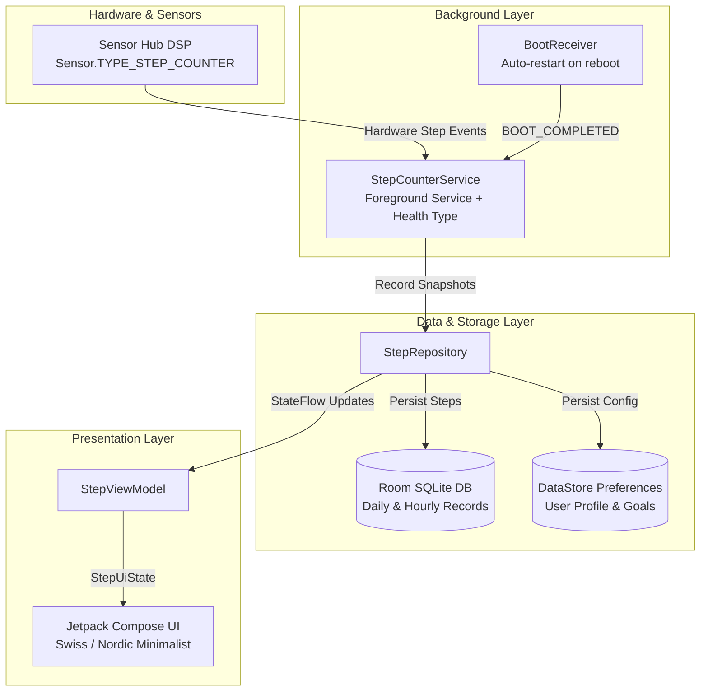

# Nordic Step Counter - Architectural Design Specification

**Date:** 2026-11-10  
**Project:** Nordic Step Counter (Clean-room Android Pedometer)  
**Target Package:** `com.nordic.stepcounter`  
**Reference App Analyzed:** `steptracker.healthandfitness.walkingtracker.pedometer` (44.5 MB)

---

## 1. Problem & Context

Commercial pedometer applications (such as the analyzed `Step.apk`) provide useful daily tracking features but are heavily weighed down by:
- Over 31 MB of multi-dex code and dynamic DEX assets dedicated to AdMob, Meta Audience Network, and tracking SDKs.
- Continuous background telemetry and telemetry services (`AppMeasurementService`, `SessionLifecycleService`, `CctBackendFactory`).
- Invasive permissions including background fine/coarse GPS location (`ACCESS_BACKGROUND_LOCATION`) and Google Advertising IDs (`AD_ID`, `ACCESS_ADSERVICES_AD_ID`).

The goal of this project is to build a modern, high-performance, battery-efficient, and privacy-respecting Android step tracker inspired by the core feature set of `Step.apk`, engineered with a **Minimalist Nordic / Swiss** design language.

---

## 2. Reverse Engineering Findings vs Clean Target

| Dimension | Reference App (`Step.apk`) | Nordic Step Counter (Clean Clone) |
| :--- | :--- | :--- |
| **Download / Install Size** | 44.5 MB (4 DEX files + dynamic asset DEX) | ~3 - 5 MB (Single DEX, stripped dependencies) |
| **Ad Networks & SDKs** | Google AdMob, Meta Audience Network, AppLovin | **None (Zero ads)** |
| **Telemetry & Trackers** | Firebase Analytics, Firebase Sessions, Google Transport | **None (Zero trackers)** |
| **Network Permission** | `android.permission.INTERNET` requested | **No `INTERNET` permission in manifest** |
| **Location Permission** | Background & Fine GPS requested | **No GPS location permissions requested** |
| **Step Sensor Logic** | Hardware `Sensor.TYPE_STEP_COUNTER` (19) + `TYPE_STEP_DETECTOR` (18) | Dedicated `Sensor.TYPE_STEP_COUNTER` (19) + `TYPE_STEP_DETECTOR` (18) fallback |
| **UI Aesthetics** | Ad banners, popups, cluttered gamification | Swiss / Nordic typography, clean monochrome with mint/blue accent |

---

## 3. High-Level Architecture

The application adopts Clean Architecture with Unidirectional Data Flow (UDF) powered by Jetpack Compose, Kotlin Coroutines, and Android Jetpack libraries.



---

## 4. Hardware Sensor Engine & Battery Strategy

1. **Low-Power Hardware Batching:**
   - Android's `Sensor.TYPE_STEP_COUNTER` (sensor ID 19) operates inside the device's low-power sensor hub DSP. It counts steps continuously without keeping the main Application Processor (CPU) awake.
   - The service registers the listener using `maxReportLatencyUs` set to a batched interval (e.g., 60 seconds) so the hardware delivers steps in batches while the screen is off.
2. **Foreground Service Lifecycle:**
   - Declared as `foregroundServiceType="health"` (compliant with Android 14+ requirements).
   - Minimalist, silent ongoing notification showing current steps and goal progress.
   - Allows users to **Pause** counting (e.g., during car or transit rides) and **Resume** seamlessly.
3. **Reboot Resilience:**
   - `BootReceiver` listens for `ACTION_BOOT_COMPLETED` and `ACTION_MY_PACKAGE_REPLACED` to automatically rebind the service.
   - Preserves cumulative sensor offsets across phone reboots.

---

## 5. Physical Calculation Models

Calculations are parameterized using the user's personal profile (stored locally in DataStore):

1. **Step Length ($L$ in meters):**
   - Default based on user height ($H$ in cm):
     $$\text{Female: } L = H \times 0.413 \div 100$$
     $$\text{Male: } L = H \times 0.415 \div 100$$
   - Can be manually calibrated in settings.
2. **Distance ($D$ in km):**
   $$D = \frac{\text{Steps} \times L}{1000}$$
3. **Active Calories Burned ($C$ in kcal):**
   - Based on standard walking MET (Metabolic Equivalent of Task $\approx 3.5$) and body weight ($W$ in kg):
     $$C = \text{Steps} \times W \times 0.00075$$
4. **Active Time ($T$ in minutes):**
   - Calculated from active walking cadences (estimated at $\approx 100\text{ steps/minute}$).

---

## 6. Nordic / Swiss UI & Design System

The visual style adheres strictly to Swiss graphic design and Nordic minimalism:

- **Palette:**
  - Background: Pure Pitch `#0A0A0A` (Dark) / Pure Off-White `#F8F9FA` (Light)
  - Surface Cards: Deep Carbon `#161616` (Dark) / `#FFFFFF` (Light) with subtle 1px border `#262626`
  - High-Contrast Numerals: Crisp White `#FFFFFF` / Pure Black `#111111`
  - Primary Energetic Accent: Electric Mint `#00E599` (used for circular progress and active indicators)
  - Secondary Accent: Cool Muted Gray `#8A8A8E` for labels and unit captions
- **Typography:**
  - High typographic hierarchy: Ultra-bold, large display numbers (e.g., 64sp for current step count).
  - Micro uppercase tracking for units (`STEPS`, `KCAL`, `KM`, `MINS`).
- **Screen Structure:**
  1. **Dashboard (Today):**
     - Radial progress indicator displaying percentage towards daily goal.
     - Large step count typography.
     - 3-column micro-metrics: Distance (km), Calories (kcal), Active Time (mins).
     - Persistent tactile Pause / Resume toggle pill.
  2. **Analytics / History:**
     - Toggleable views: Day (hourly breakdown), Week (7-day bars), Month (30-day bars).
     - Clean bar chart with touch-to-inspect tooltips.
     - Daily average and best day streak metrics.
  3. **Profile & Calibration:**
     - Height, Weight, Gender, Custom Step Length override.
     - Daily Step Goal (slider/presets: 6,000, 8,000, 10,000).

---

## 7. Data Storage & Schema

Local SQLite persistence via Android Room:

```kotlin
@Entity(tableName = "daily_steps")
data class DailyStepEntity(
    @PrimaryKey val date: String, // YYYY-MM-DD
    val steps: Int,
    val distanceMeters: Float,
    val caloriesKcal: Float,
    val activeDurationSeconds: Long,
    val goalSteps: Int
)

@Entity(
    tableName = "hourly_steps",
    primaryKeys = ["date", "hour"]
)
data class HourlyStepEntity(
    val date: String, // YYYY-MM-DD
    val hour: Int,    // 0..23
    val steps: Int
)
```

---

## 8. Security, Privacy & Safety Assurance

- **Zero Network Egress:** Manifest strictly omits `android.permission.INTERNET`. No socket or HTTP connection can be initiated.
- **Zero Third-Party Trackers:** No third-party analytics, crash-reporters, or ad mediation SDKs.
- **All Data Local:** Complete database remains on device in app private storage (`/data/user/0/com.nordic.stepcounter/databases/`).
